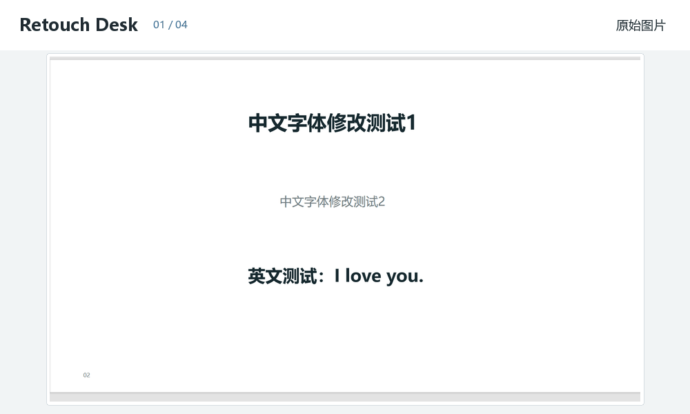
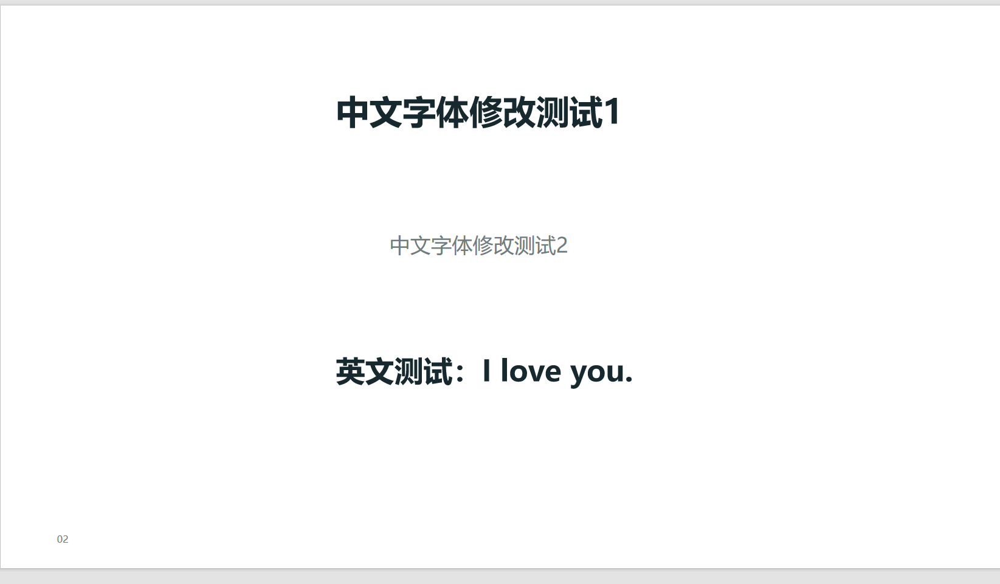
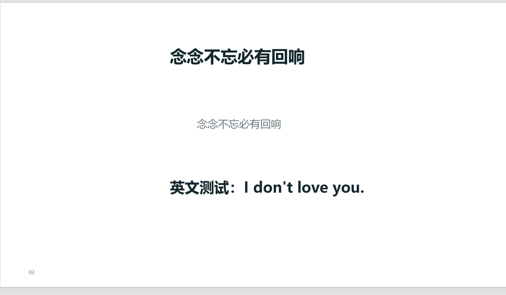
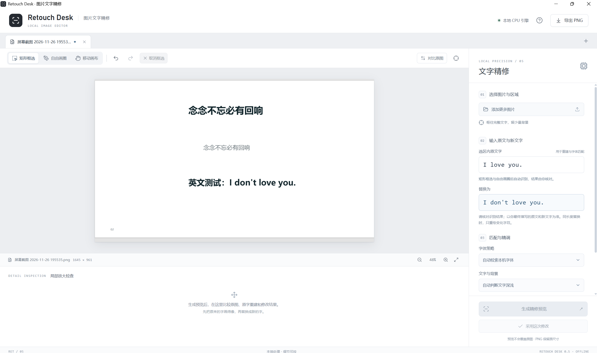
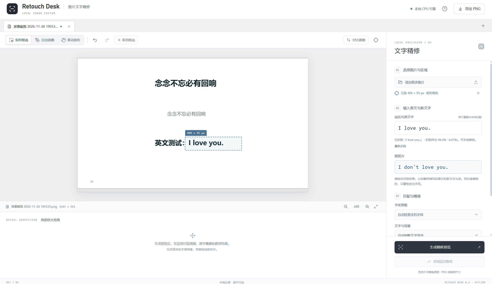
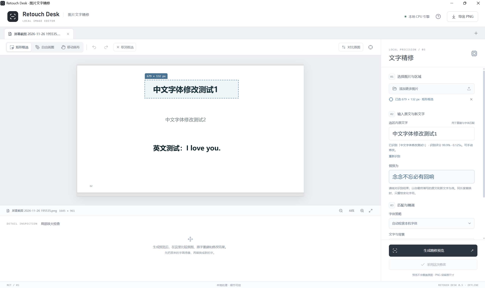

# Retouch Desk 0.5.0 | 图片中文字修改工具

Retouch Desk 是一款 Windows 桌面端**图片中文字修改工具**。打开图片后，用矩形框或自由画圈选中文字；本地 OCR 会辅助识别原文，你可以手动校对、输入替换内容、预览效果，再导出 PNG。

图片处理运行在本机 CPU 上，无需显卡、云端模型或 API Key。适用于截图、海报和演示文稿中的单行印刷文字；复杂纹理、透视、弯曲文字和手写内容仍需谨慎检查，效果取决于原图和字体。请在导出前核对预览。

**关键词：** 图片文字修改、图片改字、图片文字替换、图中文字编辑、OCR 图片文字编辑。

**Windows x64 安装包：** [下载 Retouch Desk 0.5.0](https://github.com/zhanghexiang1123-lang/retouch-desk/releases/tag/v0.5.0)

## 图片改字演示 / Demo



| 修改前 | 修改后 |
| --- | --- |
|  |  |

<details>
<summary>查看软件界面截图 / View editing screenshots</summary>







</details>

## English

Retouch Desk edits one line of text in a raster image. Select the text with a rectangle or freehand outline, check the locally recognized source text, enter a replacement, and inspect the preview before adopting or exporting it.

The Windows app runs OCR and image reconstruction locally on the CPU. It does not require a graphics card, cloud account, API key, or network access while editing. Images and edit history remain in memory until the app closes, unless you export an image.

## Install

Download `RetouchDesk-0.5.0-Setup-x64.exe` from the project's GitHub Releases and run the installer. It installs for the current Windows user, lets you choose an install folder, and can create a desktop shortcut. The app is also available from the Start menu and Windows' installed apps list.

Windows 10 version 1809 or newer and Windows 11 are supported on x64. The native desktop window uses Microsoft Edge WebView2 Runtime. If it is unavailable, the app attempts to open its local interface in the default browser.

To use the portable build, run `release/RetouchDesk/RetouchDesk.exe`. Keep the full `RetouchDesk` folder together. The existing `一键启动.bat` also starts the portable app.

## Use

1. Open one or more PNG, JPEG, or WebP images. Switch between images with the tabs.
2. Choose rectangle selection or freehand selection and include the full line of text with a little surrounding background. Press Escape or select **取消框选** to clear a selection.
3. Review and correct the OCR result, then enter the replacement text. The two text fields preserve leading zeros and decimal points.
4. Generate a preview. Compare the original crop, reconstructed source text, and result, then adjust the font or fine controls when needed.
5. Adopt a result, undo or redo recent changes, and export the current image as PNG. The original file is not overwritten.

## Editing limits

The local engine supports a single line of printed text on light or dark backgrounds. It searches a finite set of fonts installed on the current Windows computer and estimates character width, height, position, shear, rotation, blur, and ink color. Unknown fonts and different computers can produce different matches.

Complex textures, gradients, perspective, curved text, outlines, colored lettering, handwriting, and transparency are not fully reconstructed. Background repair uses OpenCV Telea inpainting and local color fitting. Preview metrics help inspect the result but do not predict whether a change is visually undetectable. Inspect the result before adopting it.

The editor leaves decoded pixels outside its change area unchanged. PNG export does not preserve the input file's original compression bytes, EXIF, or other metadata.

## Develop

Use Python 3.12 and Node.js 24 on Windows.

```powershell
py -3.12 -m venv .venv
.\.venv\Scripts\python.exe -m pip install -r requirements.txt
npm ci
npm run build
npm start
```

`npm run start:browser` opens the local interface in a browser. `npm run test:workspace` runs workspace-state tests. `npm run test:engine` runs the Python OCR and image-edit tests.

The browser-based UI checks in `scripts/ui-workspace-check.mjs`, `scripts/ui-async-check.mjs`, and `scripts/ui-appearance-check.mjs` use Playwright and Microsoft Edge. Install Playwright in the project's Node environment or set `PLAYWRIGHT_PACKAGE_JSON` to the package manifest that provides it. Set `PLAYWRIGHT_EXECUTABLE_PATH` when Edge is not available through Playwright's default `msedge` channel. Start the local server separately, then pass its URL to a check script. The browser tests use only the synthetic images in `tests/fixtures/`.

## Build Windows packages

`npm run package:windows` builds the portable folder and executable. `npm run package:installer` builds the portable app and then creates the per-user installer. `scripts/package-installer.ps1` expects Inno Setup 6 and can also compile an existing portable build with `-SkipAppBuild`.

The installer is written to `release/installer/RetouchDesk-0.5.0-Setup-x64.exe`. The build also writes a SHA-256 checksum beside the installer. The installer is not code-signed.

The Chinese Inno Setup translation is from the Inno Setup project's `is-6_7_4` source tag. Its contributor attribution is retained in `installer/ChineseSimplified.isl`; the translation is licensed under MIT. See `installer/THIRD-PARTY-NOTICES.md`.

## 许可与贡献 / License and contributions

Retouch Desk 使用自定义的“项目内使用许可”，**不属于开源许可证**。你可以运行官方发布的软件；若希望修改纳入本项目，请通过 GitHub fork 准备贡献并向本仓库提交 Pull Request。许可不授予在 GitHub 之外重新发布代码或将其打包成独立应用发布的一般权限。完整条款见 [LICENSE](LICENSE)，贡献流程见 [CONTRIBUTING.md](CONTRIBUTING.md)。

GitHub 服务条款允许用户在平台内 fork 和使用公开内容，因此本项目无法屏蔽 GitHub 站内的 fork。项目许可不授予在 GitHub 之外重新发布代码或将其作为独立产品发布的额外权限。

Retouch Desk uses a custom, project-bound source license. It is **not an open-source license**. You may run official releases. To have a change included in Retouch Desk, prepare it in a GitHub fork and submit a pull request to this repository. The license grants no general permission to republish the code outside GitHub or distribute it as a standalone app beyond rights GitHub grants through its Service. GitHub's Terms of Service allow users to fork and use public content within GitHub, so this project cannot prevent an in-service fork from being visible. See [LICENSE](LICENSE) and [CONTRIBUTING.md](CONTRIBUTING.md).

## Project layout

- `src/` contains the React workspace and editor interface.
- `backend/` contains the local image editor, OCR pipeline, and loopback server.
- `tests/` contains engine, OCR, and workspace-state tests with small synthetic image fixtures.
- `scripts/` contains build, launch, and acceptance scripts.
- `assets/` and `public/` contain the application icon.
- `installer/` contains the Inno Setup definition and installer notices.
